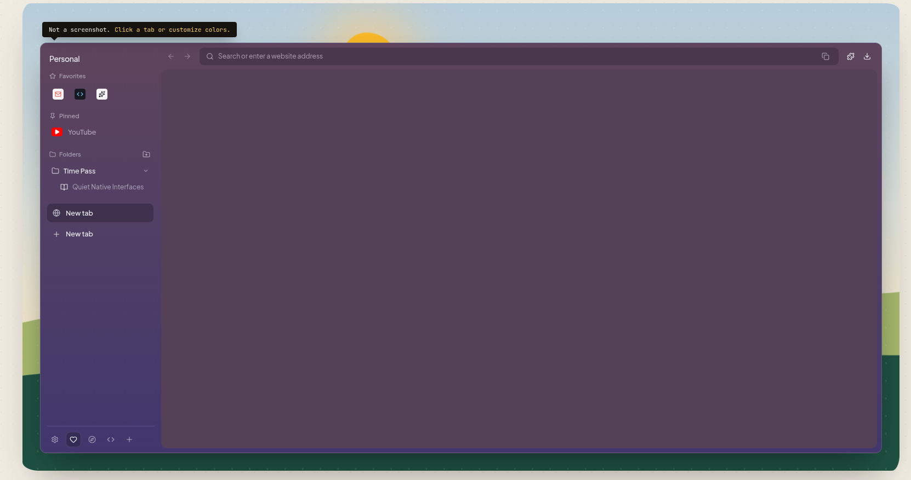

<p align="center">
  
</p>

# Anarc

**Anarc is a keyboard-first browser for Linux and Windows.** Organize tabs into spaces, keep your go-to sites in the sidebar, and work across up to four pages in a split view. Anarc uses a native Rust interface built with GPUI Kit and renders web pages with Chromium Embedded Framework (CEF).

[](https://anarc.pages.dev/#workspace)

## Features

### Browsing & interface

- **Spaces** with their own colors, a unified pinned/favorites section, folders, and isolated browser profiles.
- **Split views** for up to four tabs in a 2x2 grid with draggable dividers. Drag a sidebar tab onto a pane to split, extend, or replace it.
- **Command palette** for switching tabs, searching history, and running browser commands.
- **Built-in Shield** blocks ads and trackers with uBlock Origin–compatible filter lists and cosmetic element hiding, strips YouTube ad overlays, and upgrades eligible HTTP URLs to HTTPS. Toggle it globally in Settings or per tab with `Ctrl+Shift+B`.
- **Reader mode**, trackpad pinch-to-zoom, right-click menus for tabs, spaces, folders, and pages, and a bookmark importer for Chrome, Chromium, Brave, and Edge.
- **Downloads** with a downloads page, an active-download badge, and progress toasts.
- **Settings** with General, Appearance, Shortcuts, and Plugins sections, including a full in-app keyboard-shortcut reference and plugin enable toggles.
- **Plugin packs** for themes, site styles, search engines, and extensions. Sandboxed WebAssembly plugins are available with the optional `wasm-plugins` build feature, and plugin packages can be Ed25519-signed and verified.

### Automation & agent control

- **Anarc Agent Control** exposes a local MCP server and the `anarc-ctl` CLI/DSL so agents can drive the visible browser through `see`, `do`, `read`, `find`, `shot`, `tabs`, `tab`, `upload`, `doctor`, `status`, `pause`, and `resume`.
- **Live CDP bridge** with typed element refs, coordinate clicks, DOM and file-input actions, diff-only action output, and semantic ref recovery when the page changes.
- **Action DSL** with key chords and modifiers, `@file:` text injection, multi-file and glob uploads, drag-and-drop file ingestion, and tab actions (`pin`, `fav`, `close`, `new`, `select`). `fav` and `pin` are aliases of the same kept-tab action.
- **Policy gate** that asks for confirmation on sensitive intents such as sending a message, plus navigation restrictions.
- **Socket activation** via `anarc.socket`, on-demand start with `anarc-ctl start`, stale-socket recovery, doctor diagnostics, and up to 9 isolated instances.
- **Plugin MCP server** (`anarc_plugin_*` tools, with `lumen_*` aliases) for scaffolding, validating, building, installing, toggling, and packaging plugins, plus querying spaces and history.

### Performance & platform

- **Spring-based motion** with reduced-motion support, 240 fps hardware OSR rendering, vsync-aligned frame dispatch, and full-rate rendering in background windows.
- **Windows support** with native minimize, maximize, and close controls in the top bar.

## Installation & Building

### Linux

Build Anarc from source on Linux. Use a current stable Rust toolchain, a C/C++ compiler, CMake, `pkg-config`, and the X11 and keyboard development libraries. On a Wayland desktop, install XWayland so Anarc can use its X11 backend.

<details>
<summary>Install build dependencies</summary>

**Arch Linux**

```sh
sudo pacman -S --needed base-devel cmake pkgconf libx11 libxcursor libxrandr libxi libxkbcommon libxkbcommon-x11
```

**Debian and Ubuntu**

```sh
sudo apt install build-essential cmake pkg-config libx11-dev libxcursor-dev \
  libxrandr-dev libxi-dev libxkbcommon-dev libxkbcommon-x11-dev
```

**Fedora**

```sh
sudo dnf install gcc gcc-c++ make cmake pkgconf-pkg-config libX11-devel libXcursor-devel \
  libXrandr-devel libXi-devel libxkbcommon-devel libxkbcommon-x11-devel
```

</details>

```sh
git clone https://github.com/rover-001/anarc.git
cd anarc
./install.sh
```

The installer builds Anarc, installs the CEF runtime, and adds a desktop launcher. Open **Anarc** from your app launcher or run `~/.local/bin/anarc`. The first build downloads the version of CEF pinned in [Cargo.lock](Cargo.lock). If you already have the matching CEF distribution, set `CEF_PATH` to the extracted directory containing `libcef.so` and the CEF archive metadata, then run the installer.

Run `./install.sh --help` for installer options.

To run directly from the checkout, use `cargo run --locked --release`. For a build with WebAssembly plugin support, use `cargo run --locked --release --features wasm-plugins`.

### Windows

There is no Windows installer yet; build from source on Windows with the MSVC toolchain. Install a current stable Rust toolchain with the `x86_64-pc-windows-msvc` target, Visual Studio Build Tools (C++ workload and Windows SDK), CMake, and Ninja, then run in PowerShell:

```powershell
git clone https://github.com/rover-001/anarc.git
cd anarc
cargo build --locked --release
```

Run `target\release\anarc.exe`. The CEF runtime files (`libcef.dll`, `*.pak`, `locales\`, etc.) are copied next to the executable by the CEF build script, so ship them together in any archive. The Windows build adds native minimize, maximize, and close buttons to the top bar. `anarc-ctl` currently requires Unix sockets and is not usable on Windows.

<details>
<summary>Cross-building Windows from Linux (experimental)</summary>

CEF's build script supports Linux → Windows MSVC cross-builds through [`cargo-xwin`](https://github.com/rust-cross/cargo-xwin). The Windows GNU target is not accepted, so use the MSVC target. On Arch Linux:

```sh
rustup target add x86_64-pc-windows-msvc
sudo pacman -S --needed llvm lld ninja
cargo install --locked cargo-xwin --version 0.24.1
export XWIN_ARCH=x86_64
```

Two source changes are required before building:

1. **`build.rs`** — the `embed_resource::compile("assets/anarc.rc", …)` call is wrapped in a host-side `#[cfg(target_os = "windows")]`, which is false on a Linux host. Remove that `#[cfg]` (keep the existing `CARGO_CFG_TARGET_OS == "windows"` guard) so the icon and version metadata are embedded with `llvm-rc`. Skipping this only affects file metadata.
2. **`vendor/gpui-pre-windows/build.rs`** — release builds include an `OUT_DIR/shaders_bytes.rs` generated by the Windows-only `fxc.exe`. Generate it once on a Windows machine with `cargo build --release -p gpui-pre-windows`, copy the file to `vendor/gpui-pre-windows/src/shaders_bytes.rs`, and add a Linux-host fallback in that build script that copies it into `OUT_DIR` when `CARGO_CFG_TARGET_OS=windows`. Without this the release build cannot compile.

Then build and package:

```sh
export RUSTFLAGS="-C target-feature=+crt-static"
export XWIN_ARCH=x86_64
cargo xwin build --release --target x86_64-pc-windows-msvc --bins

cd target/x86_64-pc-windows-msvc/release
zip -r ../../../anarc-windows-x86_64.zip \
  anarc.exe anarc-ctl.exe *.dll *.pak *.bin *.json locales/ plugins/
```

The first build downloads the MSVC CRT/SDK through xwin and the Windows CEF distribution, so it is slow. Cross-building proves compilation only — GPU initialization, CEF sandboxing, fonts, notifications, and plugin loading still need a real Windows smoke test. The zero-patch alternative is building on a native Windows machine as described above.

</details>

### macOS

**Anarc is not natively supported on macOS yet.** `install.sh` refuses to run on macOS, the installer expects a Linux CEF runtime containing `libcef.so`, and there is no macOS app bundle, CEF helper apps, or macOS build here. Cross-compiling macOS from Linux is also not possible without an Apple SDK, which cannot be redistributed.

The supported option is to run the Linux build in an x86_64 Linux VM or dual boot, then follow the Linux instructions above:

```sh
git clone https://github.com/rover-001/anarc.git
cd anarc
./install.sh
~/.local/bin/anarc
```

Building from source on a macOS host is experimental and unsupported: do not run `install.sh`, and expect manual CEF work, since the project does not create an app bundle or load the CEF framework before initialization. No macOS support is provided.

## Keyboard shortcuts

| Shortcut | Action |
| --- | --- |
| `Ctrl+L` | Focus the address bar |
| `Ctrl+K` | Open the command palette |
| `Ctrl+T` / `Ctrl+W` | Open or close a tab |
| `Ctrl+Shift+T` | Reopen a closed tab |
| `Ctrl+1` … `Ctrl+9` | Jump to tab (`9` = last) |
| `Ctrl+Tab` / `Ctrl+Shift+Tab` | Cycle through tabs |
| `Ctrl+Shift+S` / `Ctrl+Shift+W` | Split view / add pane pair, or exit split view (max 4) |
| `Ctrl+Alt+←` / `→` | Focus a split pane |
| `Alt+←` / `→` | Back / forward |
| `Ctrl+R` / `Ctrl+Shift+R` | Reload / hard reload |
| `Ctrl+F` | Find on the current page |
| `Ctrl+S` | Toggle the sidebar |
| `Ctrl+Alt+R` | Reader mode |
| `Ctrl+=` / `-` / `0` | Zoom in / out / reset |
| `Ctrl+Shift+B` | Toggle Shield for the active tab |

## Configuration

| Environment variable | Default | Contents |
| --- | --- | --- |
| `ANARC_CONFIG_DIR` | `~/.config/anarc` | Spaces and plugin configuration |
| `ANARC_DATA_DIR` | `~/.local/share/anarc` | Browser preferences, history, and per-space CEF profiles |

Set both variables to fresh directories to test with a separate profile.

## Development

- [`src/app`](src/app) contains browser actions, application state, and the window shell.
- [`src/engine`](src/engine) integrates with CEF and handles input and page rendering.
- [`src/plugin`](src/plugin), [`lumen-plugin-sdk`](lumen-plugin-sdk), and [`wit`](wit) define the plugin runtime and interfaces.
- [`plugins`](plugins) contains the shipped plugin packs (theme, YouTube userstyle, vim-style keymap, search pack). [`examples/plugins/tidy-tabs`](examples/plugins/tidy-tabs) is the WebAssembly guest example; it needs `--features wasm-plugins` and a compiled component to run.

Report bugs in [GitHub Issues](https://github.com/rover-001/anarc/issues). Include your Linux distribution, desktop environment, and steps to reproduce.

Third-party notices for the bundled reader and filter lists are in [assets](assets).
